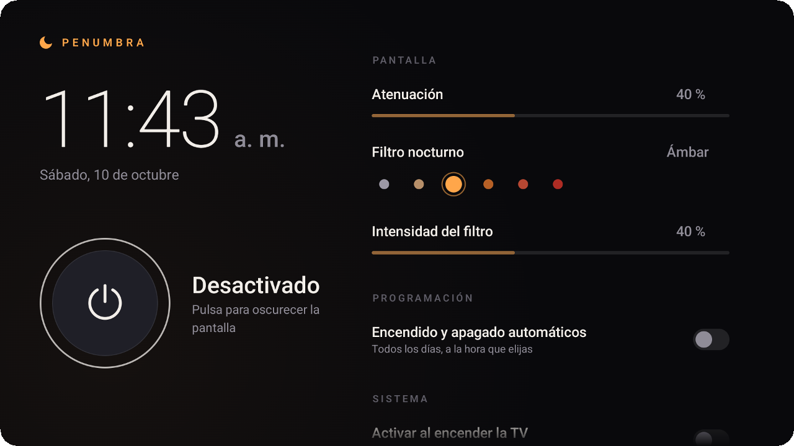
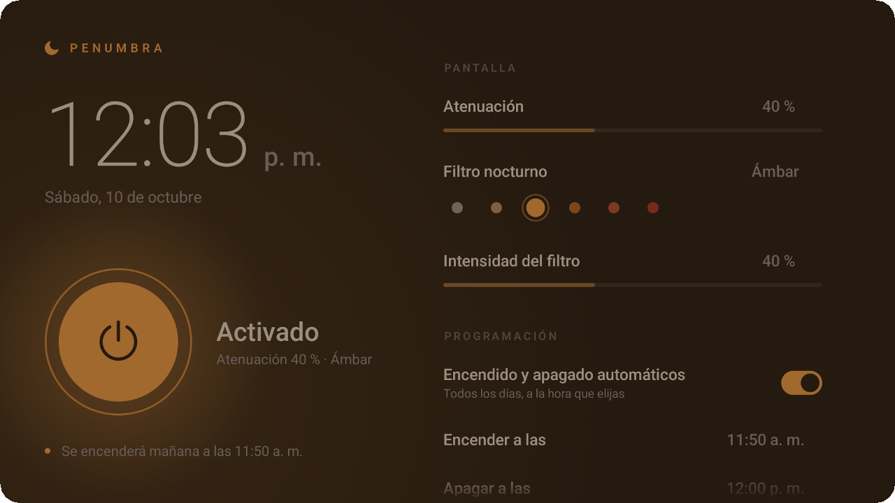
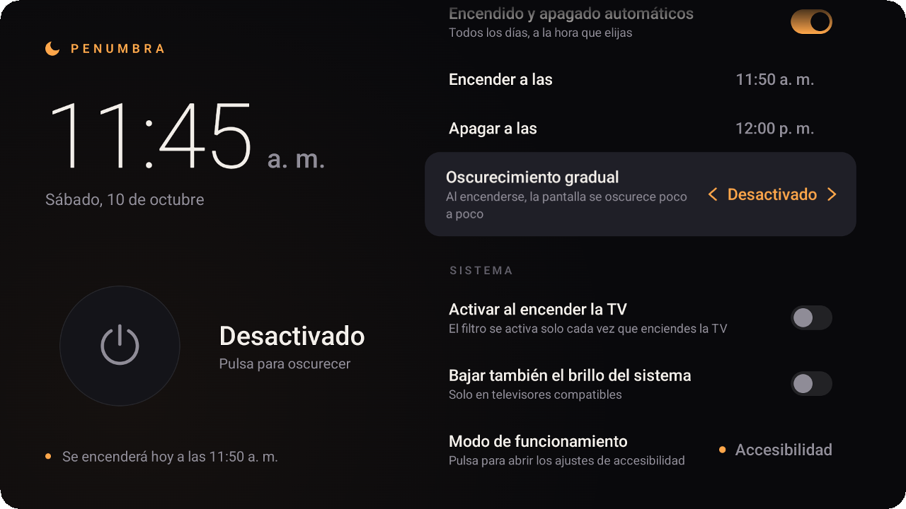

<p align="center">
  
</p>

<p align="center">
  Dim your TV, warm up its colours and let it switch itself on and off every night.<br>
  Easy on the eyes. Made for the remote.
</p>

<p align="center">
  <a href="../../releases/latest/download/Penumbra.apk"></a>
  
</p>

<p align="center">
  
  
</p>

<p align="center"><sub>🇪🇸 <a href="README.es.md">Leer en español</a></sub></p>

## ✨ Features

- 🌗 **Dim the screen** from 0 to 100 %, on top of any app.
- 🎨 **Night tones**: Neutral, Warm, Amber, Candle, Sunset and Red, with adjustable intensity.
- ⏰ **Daily schedule** that turns the filter on and off by itself, even across midnight (22:00 → 07:00).
- 🌅 **Gradual dimming** that fades the screen in slowly when the schedule starts.
- 📺 **Starts with your TV**: optionally switches on every time the TV wakes up.
- 🎮 **Remote-first**: one clean screen, every setting a few clicks away.

> [!NOTE]
> The app's interface is in Spanish. The [settings table](#-settings) below translates every option.

## 📦 Install

**1. Download** `Penumbra.apk` from the [latest release](../../releases/latest).

**2. Send it to your TV.** The easiest way is from a computer with [ADB](https://developer.android.com/tools/releases/platform-tools):

- On the TV, open **Settings › System › About** and click **Android TV OS build** 7 times.
- In **Settings › System › Developer options**, turn on **USB debugging**.
- Find the TV's IP address in **Settings › Network & Internet**, then run:

```bash
adb connect 192.168.1.50:5555
adb install Penumbra.apk
```

Accept the *Allow debugging?* prompt on the TV the first time.

<details>
<summary>Getting <i>connection refused</i>? (Android 14 devices such as the Google TV Streamer)</summary>
<br>

Open **Developer options › Wireless debugging › Pair device with pairing code** and use the address and code shown on the TV:

```bash
adb pair 192.168.1.50:PAIRING_PORT
adb connect 192.168.1.50:PORT
adb install Penumbra.apk
```
</details>

<details>
<summary>No computer?</summary>
<br>

Install **Send Files to TV** on your phone and on the TV, send the APK, and open it with a file manager on the TV (allow it to install unknown apps when asked).
</details>

**3. Open Penumbra** on the TV and press **Abrir accesibilidad › Penumbra › Enable**. That's it.

## 🎮 Using it

<p align="center">
  
</p>

| Remote | Action |
|:---:|---|
| ⬆️ ⬇️ | Move between settings |
| ⬅️ ➡️ | Change the value (hold to jump faster through times) |
| **OK** | Turn on / off, toggle a setting |
| **Back** | Return to the power button |

Changes apply instantly: the app itself sits under the filter, so you see the result as you adjust it.

## ⚙️ Settings

| In the app | What it does |
|---|---|
| **Atenuación** | How dark the screen gets |
| **Filtro nocturno** | Colour tone: Neutro, Cálido, Ámbar, Vela, Ocaso, Rojo |
| **Intensidad del filtro** | Strength of the colour tone |
| **Encendido y apagado automáticos** | Turns the daily schedule on |
| **Encender a las · Apagar a las** | Start and end time |
| **Oscurecimiento gradual** | How long the fade-in takes at the start time (off, 5, 15, 30 or 60 min) |
| **Activar al encender la TV** | Switches the filter on whenever the TV wakes up or restarts |
| **Bajar también el brillo del sistema** | Also lowers the system brightness, on TVs that support it |

## 🔒 Privacy

Penumbra draws its filter through an accessibility service, because that is the only kind of overlay Google TV lets you enable from its own settings.

Android shows the same generic warning for every accessibility service, but Penumbra **doesn't read anything**: the service receives no events and has no access to what's on screen. The app has **no internet permission** and collects no data.

<details>
<summary>Prefer not to use accessibility?</summary>
<br>

Grant the *display over other apps* permission over ADB instead:

```bash
adb shell appops set com.penumbra.tv SYSTEM_ALERT_WINDOW allow
```

To let Penumbra lower the system brightness as well (supported TVs only):

```bash
adb shell appops set com.penumbra.tv WRITE_SETTINGS allow
```
</details>

## 🛠️ Build from source

Requires JDK 17 or 21 and the Android SDK (platform 35). Clone the repository, then:

```bash
./gradlew assembleRelease
```

The APK is written to `app/build/outputs/apk/release/`. Run the tests with `./gradlew testDebugUnitTest`.

To sign with your own key, copy `keystore.properties.example` to `keystore.properties` and fill it in. It is ignored by git.

Built with Kotlin and Jetpack Compose for TV, using AndroidX libraries only.

## 💡 Good to know

- An overlay lowers how bright the picture *looks*; it can't turn down the panel's backlight.
- Colour tones slightly lift the blacks. This is true of every overlay-based screen filter on Android.
